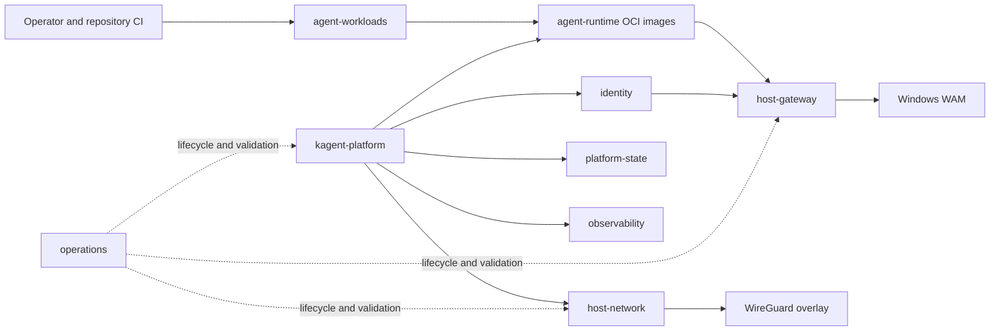

# Architecture

## Boundaries

- `host-network` establishes stable node and cluster-to-host connectivity.
- `kagent-platform` owns control-plane, worker, actor/session, and golden-snapshot lifecycle.
- `agent-runtime` supplies repository-neutral execution images.
- `agent-workloads` supplies repository-specific derived images and deployment values.
- `identity` authorizes actors, profiles, resources, policy, and plugin preparation.
- `host-gateway` performs host-only WAM, IMDS, Agency, and inference operations.
- `platform-state` and `observability` are independently deployable dependencies.
- `operations` coordinates lifecycle without becoming another implementation of each package.
