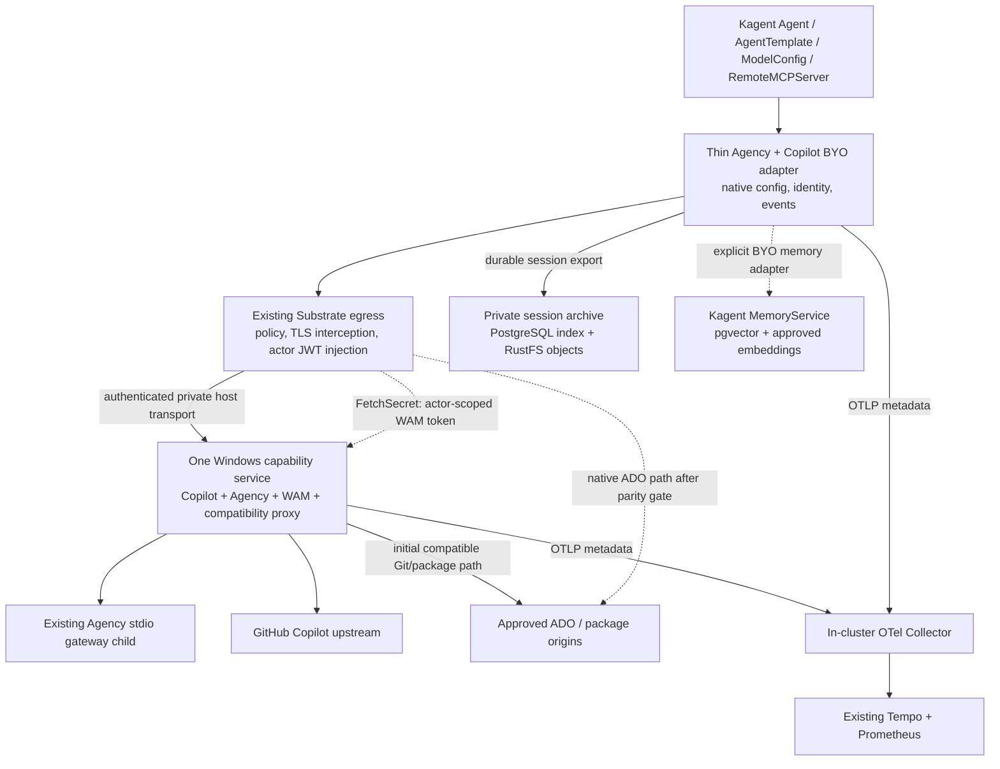

# Host capabilities and Kagent consolidation plan

**Status:** proposed architecture and staged implementation plan, 2026-11-03.
No implementation or runtime configuration changes were made for this planning task.
[Environment index](README.md) | [Source-backed findings](CONSOLIDATION-RESEARCH.md).

## Recommendation

Build **one per-user Windows capability service**, retaining the existing Copilot subscription adapter, Windows WAM
authority, and Agency gateway. Make the Copilot/Agency BYO harness a thin consumer of Kagent's compiled configuration,
rather than a parallel source of model/tool configuration. Use Substrate's native actor identity and egress plumbing
where it already supplies the required behavior.

Add a standard in-cluster OTel Collector for host metadata telemetry. Separately archive the bespoke agents' SDK
session events for mining; do not make sampled traces or actor snapshots the transcript database.
Reuse Kagent's memory API and PostgreSQL where its current constraints can be met.

For ADO, **target native Substrate interception plus a thin Windows WAM credential provider**, but retain the existing
ADO proxy module until real-client and policy-parity tests pass. Its credential injection overlaps Substrate; its
feed/method/redirect policy does not automatically overlap.

### Decisions already supplied

| Decision | Planning boundary |
|---|---|
| ADO access tokens may be available to the cluster, not agents | Short-lived delegated tokens may reach authenticated, trusted egress infrastructure. WAM, long-lived credentials, and interactive sign-in remain on Windows. Do not write ADO tokens into actors or Kubernetes Secrets. |
| Archive bespoke sessions privately | Capture bespoke-agent messages, tool events, and results in an access-controlled archive with redaction. Do not extend capture to unrelated interactive Agency/Copilot sessions. |

Assumption for review: "one service" means one supported background service/lifecycle in the signed-in Windows user's
session, not a LocalSystem Windows SCM service. WAM and Agency user authentication make that distinction important.

## Target ownership



This is not a new general-purpose agent platform. Kagent still owns agent definitions and sessions; Substrate owns
execution/isolation; Agency supplies its existing tools/plugins; the host service owns host-only capabilities.

## 1. One Windows capability service

Use the existing .NET implementations rather than introduce another proxy product or rewrite their protocols.
The host should own:

| Module | Reuse | Preserve |
|---|---|---|
| Copilot Responses | `LocalLlmGateway` token exchange, catalog, streaming relay, admission limits | Host-only GitHub credential, byte-preserving SSE, no inference replay, actual entitlement checks |
| Agency MCP/plugins | Existing broker policy and one shared Agency stdio gateway child | Actor/profile binding, nested tool permissions, plugin/hash/hook review, cancellation isolation |
| ADO compatibility | `AdoDevProxy` WAM provider, CA/state, request/redirect policy | Canonical URLs, 1ES feeds, Git write semantics, existing trust until an approved replacement works |
| Native WAM provider | New adapter implementing existing `CredentialProvider.FetchSecret` | Only authenticated egress may fetch, verified actor scope, no token-returning actor API |
| Common operations | .NET host lifetime, configuration, OTel, readiness | Explicit host login/recovery, safe errors, bounded resource use |

One service does **not** require one TCP port or the removal of the Agency executable child.
Initially keep legacy model/MCP/proxy ports as compatibility listeners owned by the same service.
CONNECT interception and ordinary HTTP APIs have different transport requirements.

Refactor the C# applications into reusable hosting modules under one versioned solution, retaining their current tests.
Port the small Python broker's policy/transport only with fixture parity; a supervised broker child is a transitional
step, not proof that the final integration is complete. Do not rewrite Agency's gateway itself.

Required service behavior:

- One logon startup registration, one operational configuration, explicit `login`/`doctor`/`serve`-style operations.
  Preserve existing credential/CA stores initially; no implicit sign-in, credential copying, or CA rotation.
- Independent capability readiness. Expired GitHub authorization must not take ADO or MCP down; an unavailable Agency
  child must not stop model traffic. Expose process liveness separately from capability health.
- Independent concurrency limits, timeouts, admission, and circuit state for model streams, MCP, plugins, and packages.
  A shared process is a larger failure domain; consolidation must not create one shared blocking lock.
- Graceful drain; no replay of accepted model requests, Git writes, or MCP writes after cancellation/restart.
- Fresh actor/profile authorization per request. Do not trust caller-supplied identity headers merely because traffic
  came from a relay.

Keep the currently necessary Windows/WSL transport while replacing the application plumbing. Remove its credential
handling and extra protocol logic only after an end-to-end TLS/identity canary proves a simpler transport.
Do not combine a Windows networking/firewall redesign with the first service refactor.

## 2. Make the BYO harness Kagent-native

**The important discovery:** BYO is already an intended Kagent extension point. It receives native compiled model/MCP
configuration. There is not a mandatory central model/MCP proxy that our harness merely forgot to call.
The present harness consumes only a small portion of the contract and hardcodes much of the rest.

Keep Copilot/Agency as the runtime. Implement this narrow, validated mapping:

| Kagent compiled behavior | Copilot/Agency adaptation |
|---|---|
| `agent.model.model` | SDK model selection; remove hardcoded model name |
| `agent.model.openai.base_url` / `api_format` | Provider `baseUrl` / `wireApi`; first support OpenAI Responses only |
| `agent.model.headers` | SDK `ProviderConfig.headers`, preserving compiled credential/header rules |
| Compiled credential placeholder | SDK placeholder credential; Substrate injects the real actor JWT or approved credential |
| `agent.instruction` | Effective agent instruction, with required adapter safety policy kept distinct |
| `agent.http_tools` / `sse_tools` | SDK MCP servers: URL, headers, protocol, selected tools, timeout |
| `require_approval` | Permission callback; not an invented MCP config property |
| Runtime controller URL/identity and telemetry | Existing authenticated runtime client and standard OTel configuration |

Use `AgentTemplate.modelConfig` and `AgentTemplate.tools` as the model/tool configuration authority.
Represent the host Agency gateway as a `RemoteMCPServer`, initially exposing its existing gateway tools.
Kagent's selection of `call_tool` cannot enforce the nested tool's arguments or repository/branch scope:
the host profile policy must remain authoritative for those restrictions.

Target **actor JWT authentication first**:

1. Declare host model/MCP destinations through native resources.
2. Kagent compiles placeholder headers and default-deny egress grants.
3. Substrate mints/injects the actor token; the host validates issuer, audience, expiry, actor identity, and profile.
4. Once equivalent, remove the extra `/session` RAM-lease exchange and actor loopback model/MCP adapters for this path.
   Keep the package adapter until the ADO replacement gate passes.

Use distinct model/MCP DNS names for policy clarity even if both terminate in one process. A shared DNS origin can work
with identical audience/header semantics, but later credential differences would otherwise conflict.

Compatibility boundaries:

- Initial adapter rejects unsupported providers and caller `tokenPassthrough`/STS configurations rather than silently
  ignoring them. Actor JWT does not require implementing caller-token STS.
- SDK `SessionConfig.streaming` governs event delivery, **not** guaranteed provider request streaming. Initially reject
  compiled `agent.stream=false`; do not pretend that setting SDK event streaming false implements it.
- Keep strict certificate verification. Native resources currently lack a custom-CA input. Prove a supported image/
  gateway trust configuration, or retain the existing narrowly scoped trust overlay while pursuing upstream support.
  Do not use `disableVerify` as the migration strategy.
- Map only capabilities the adapter implements. BYO composition readiness does not automatically validate every
  Copilot-specific restriction; run adapter preflight before accepting work.
- Kagent sessions pin revisions. Canary new sessions; do not silently repoint active sessions or adopt another actor's
  cached identity after a fork/restore.

## 3. Host telemetry back into Kubernetes

Add **one standard OTel Collector**, not another dashboard/backend.
Use .NET `ActivitySource`, `Meter`, ASP.NET/HTTP instrumentation, and OTLP export.
Preserve W3C trace context through the adapter, Substrate path, remaining relays, host, and Agency child correlation.

| Signal | Proposed route |
|---|---|
| Host and bespoke-runtime traces | OTLP -> Collector -> existing Tempo |
| Host counters/gauges/histograms | OTLP -> Collector Prometheus exporter -> existing Prometheus/ServiceMonitor |
| Existing Kubernetes logs | Keep existing Promtail -> Loki path |
| Host OTLP logs | Separate compatibility gate; deployed Loki 2.6.1 must not be assumed to accept modern native OTLP logs |

Windows currently has no observed explicit overlay/service-network routes. Do not point its exporter at cluster DNS
and assume it works. First use an owned, loopback-only WSL Kubernetes forward to the collector with TLS/authentication,
normal certificate validation, and no global Windows trust-store change. A later private network endpoint can replace
that access mechanism if justified. Collector access must never become public anonymous ingress.

Configure a ServiceMonitor with the existing Prometheus release selector. Use bounded queues, batching, memory limits,
and visible drop/export-failure metrics. Telemetry outages must not stall inference or cause business-request retries.
Do not add Kafka or a separate host collector solely to make routine telemetry lossless.

### Measure what the host actually knows

| Instrument | Meaning |
|---|---|
| Active model requests/streams; duration and first-byte latency | Actual accepted/in-flight inference, not an inferred conversation count |
| Active MCP sessions; opens/closes/expiry | Logical MCP initialization/session lifecycle, including abandoned-session expiry |
| Model/MCP/tool calls and durations | Count both outer gateway tools and authorized nested toolset/tool names |
| Gateway HTTP status, upstream HTTP status, JSON-RPC error, MCP `isError` | Separate outcomes; HTTP 200 is not sufficient proof of a successful tool or stream |
| Policy denials, rate limiting, timeouts, cancellations | Finite classified outcomes, not raw diagnostic text |
| Token usage when actually reported | Preserve unknown/partial values; do not invent billing cost from subscription traffic |
| Host authorization readiness, Agency child health, export failures | Dependencies that pod readiness currently misses |

Keep Kagent session ID, SDK session ID, actor UID, MCP session ID, and A2A task ID distinct.
Record them on authorized trace/event correlation, not high-cardinality metric labels.
Metric dimensions should be bounded: module, operation, approved tool/profile, model, and outcome.

The host cannot reliably count active Kagent conversations from HTTP sockets alone. Use runtime lifecycle correlation,
or label a measure as "recently active" with an explicit window rather than claiming exact active sessions.
Nested MCP result codes are reported only when available; the host cannot manufacture downstream HTTP codes hidden by
an upstream tool.

Telemetry is **metadata only**. Never emit prompts, tool arguments/results, credentials, signed package URLs, or raw
upstream bodies. Generic auto-instrumentation needs explicit URL/query/header filtering.
Observe SSE terminal outcomes/usage without changing response bytes, buffering entire streams, or delaying delivery.
Select one producer for usage counters to avoid counting the same call in the harness, host, and gateway.

Native Kagent content capture is not the archive solution: its tool spans can include payloads even when model content
capture is false. Apply a collector-side metadata allowlist as defense in depth.

## 4. Durable useful memory, not indiscriminate transcript recall

Separate:

- **Conversation continuity:** existing Copilot session state plus deployed `VOLUMES` snapshots and reconstruction.
- **Episodes:** the private session archive described below.
- **Reusable memory:** compact, scoped findings promoted from evidence and retrieved in later invocations.

Prefer Kagent's existing `MemoryService`, with a thin BYO tool/client adapter. It already supports actor-authenticated
calls, and derives memory scope from the persisted session's Agent and creator; an actor cannot select another user
merely by supplying request fields.

This is not automatically enabled for BYO. The pinned implementation requires:

1. A verified authenticated runtime client and a scope-isolation canary.
2. Exactly **768-dimensional embeddings** from an approved provider.
3. pgvector and the expected vector schema/role permissions. The deployed stock `postgres:18-alpine` image does not
   bundle pgvector; plan a backed-up, compatible image/schema change, not another database product.
4. Explicit embedding configuration and permitted egress for BYO. Its empty `BYOHarness` has no native memory switch.

The current GHCP gateway implements Responses/models, not an embeddings service.
Choosing an approved embedding endpoint is an outstanding enabling decision, not an assumed subscription feature.
When embeddings are unavailable, report memory unavailable and retain the episode; never fabricate/truncate vectors
or silently change providers.

Initial policy:

- Scope memory to the actual Agent/creator and repository context. Cross-role/shared knowledge is explicit, not a
  global user-memory bucket. Do not treat metadata tags alone as authorization.
- Retain source session/task, repository/revision, supporting result, confidence, and review/provenance in metadata.
- Automatically propose findings from completed episodes; do not promote raw tool/model text into trusted instructions.
  Shared conventions/skills should use reviewed, versioned artifacts/PRs.
- Reuse native TTL/list/delete behavior, with an explicit pruning check. Expired rows are not necessarily immediately
  invisible before pruning; popularity extension is not proof of truth.
- Test repeated invocation, contradiction, stale repository state, deletion, and cross-agent/user isolation.

While the embedding/pgvector gate is pending, useful reviewed repository instructions and skills can be retained as
ordinary versioned artifacts. Do not introduce a bespoke vector store or claim that per-actor files are automatically
shared memory.

## 5. Private session exports and improvement loops

**Use the SDK event interface, not snapshots or sampled OTel spans, as the rich-session capture seam.**
The pinned Kagent APIs persist A2A tasks/history and session metadata, but expose no complete SDK transcript export RPC.
Agency's UI relay is owning-daemon/private and can miss resumed history; it is not an automatic archive for these actors.

Keep `enableSessionStore:false` unless shared SDK cross-session search is independently desired.
That setting disables the shared search/index store; it does **not** by itself disable durable event logs or resume.

Implementation shape:

1. Subscribe to documented SDK session events and record an append-only, versioned event envelope.
2. Reconcile through bounded SDK event-log cursors and `getEvents()` at completion/restart. Surface cursor expiry,
   missing history, missing terminal events, and recovery gaps rather than labeling partial data complete.
3. Keep a durable local outbox in the existing actor data volume. Dedupe by stable session/source-event identity.
4. Write compressed JSONL objects under a separate private RustFS archive prefix/bucket; retain an index/manifest and
   upload checkpoints in PostgreSQL. Reuse scoped authenticated storage access where available; if insufficient, add
   only a narrow authenticated ingestion endpoint to the existing integration, not a general new data platform.
5. Link native Kagent task/session outcomes to archive manifests; preserve A2A as task authority.
6. Retry export, never the underlying model/tool/Git operation. A completed contribution remains completed even if
   export is pending; expose that pending state and retain the outbox.

Archive envelopes should identify Kagent Agent/revision/session/task, Substrate actor/runtime, SDK session/event/parent,
timestamp/sequence, event type, schema version, and redaction version. Manifests include event counts, hashes, cursor
bounds, and completeness/gap status. Store source/artifact content only within the approved bespoke-session scope.
Do not copy live SQLite databases as a transcript API.

Redact credentials and signed URLs **before durable archival**, not just before a later dashboard query.
Keep mining projections minimized and access-controlled; full logical conversation/tool content remains sensitive even
after credential redaction. Known-pattern redaction is not a guarantee that every sensitive datum was recognized.
Only documented emitted events can be exported; do not promise hidden runtime/model state.

Define separate retention for episodes, indexes, derived memories, and backups. Suggested values are a policy decision,
not silently chosen here. Normal Kagent idle-session expiry must not delete an unexported session accidentally.
Explicit forget/delete operations need coordinated archive/memory tombstones and documented backup retention.

Improvement loop: completed episodes -> candidate lessons/skills -> offline replay/evaluation -> reviewed promotion.
Use existing Kubernetes jobs or the existing campaign tooling for bounded analysis; no new workflow engine.
Do not automatically modify production instructions, fine-tune models, or execute historical writes during replay.

## 6. ADO MITM: overlap, but not a drop-in duplicate

Substrate already terminates/intercepts HTTPS for actor egress. Therefore a **second** ADO-specific TLS interception
layer is not fundamentally necessary for credential injection. Removing it still leaves TLS interception at Substrate;
this is not a proposal for credential injection into opaque TLS.

The user-approved target boundary makes a native route plausible:

```text
Git / npm / NuGet with inert authorization placeholders
  -> Substrate/agentgateway HTTPS interception
  -> FetchSecret over authenticated mTLS to Windows WAM module
  -> short-lived ADO token held/injected only by trusted egress
  -> approved ADO / package origin
```

The active AGW protocol already supports external credential providers. The pinned setup installer supports multiple
named providers, but its Helm template hardcodes `k8s.io`: this is primarily a chart/deployment integration gap.
Kagent's ordinary EgressPolicy also lacks an arbitrary external-provider URI field; bridge that declaratively or through
a small reviewed compiler extension/upstream contribution, not unmanaged patches to live actors.

Four important non-equivalences:

| Existing ADO behavior | Native replacement requirement |
|---|---|
| Injects auth even when a standard client sends none | Active AGW docs require a replaceable header. Prove Git/npm/NuGet placeholder behavior with unchanged canonical URLs/lockfiles. |
| WAM refresh and safe-read recovery | AGW's documented actor/URI cache is five minutes; `FetchSecret` returns no expiry. Define expiry margin, revocation lag, 401/timeout behavior against the actual AGW version. |
| Organization/feed, HTTP method/path, NuGet resource restrictions | Native origin allowlisting is not equivalent. `FetchSecret` only receives URI and actor identity, not enough request context to enforce all these rules by itself. |
| Exact signed-CDN capabilities and no bearer leakage | Prove redirect/resource handling and no credential injection to content hosts, without broadening access to all URLs on an allowlisted shard. |

**Keep the ADO proxy inside the unified host initially.** Run an isolated native-ADO spike in parallel.
Retire its interception module only when successful Git fetch/push, npm consumption/audit, NuGet restore, denial cases,
refresh/outage, signed redirects, and no-write-replay behavior meet the accepted policy.
If parity would require a larger custom policy engine than the current module, keeping that module is the simpler
supported design. Acceptance of cluster-held tokens does not imply acceptance of weaker feed or write policy.

Do not project actual tokens into Git helpers, `.npmrc`, `NuGet.Config`, process arguments, or actor files.
Any required placeholders are inert. Public npm fallback and package publishing remain outside the approved scope.

## Migration sequence and completion gates

| Phase | Deliverable | Gate before moving on |
|---|---|---|
| 0. Preserve baseline | Versioned supported source/config, current protected backup, protocol fixtures and one isolated canary Agent | Restore proof for today's schemas/identities; no changes to active sessions |
| 1. Host composition | One per-user host; existing APIs/CA/credentials retained; capability health and bounded failure isolation | Existing model/MCP/ADO contract tests pass; explicit outage/restart/drain tests; legacy clients still work |
| 2. Telemetry foundation | Collector + host metadata traces/metrics + correlation | Windows-to-collector TLS/auth works; correct counts/statuses; no sensitive payloads or unbounded labels |
| 3. Native harness canary | Compiled ModelConfig/RemoteMCPServer consumption and actor JWT host admission | Correct headers/tool permissions, strict TLS, unsupported config rejection, cold restore/fork identity, live smoke only with approval |
| 4. Session archive | SDK event recorder, cursor reconciliation, durable outbox, private object/index export | Repeat export/restart yields no duplicates; gaps visible; archive outage never replays business work |
| 5. Useful memory | Native MemoryService adapter, approved embeddings, pgvector deployment | 768-dimension/schema/scope/TTL/delete canary; provenance/review rules; no cross-user/repository leakage |
| 6. Native ADO spike/cutover | Windows WAM FetchSecret module + Helm/compiler integration + client/policy equivalence | Entire parity matrix passes before retiring the legacy module; otherwise retain it |
| 7. Remove superseded plumbing | Old host daemons/tasks, unnecessary lease/loopback adapters, unused integration/Argo artifacts | No consumers; fresh sessions and recovery work; rollback preserved; no disk/secret-volume deletion |

Phases 2 and 4 can begin alongside host composition. The native ADO experiment is not a prerequisite for native
model/MCP alignment or telemetry. Memory waits for its embedding/database boundary, not for rewriting every gateway.

Use additive canary names and support old/new host routes during cutover. Roll back by directing new sessions to the
accepted old configuration; preserve already-running pinned revisions and uncertain-task identity.
Do not combine this with a Kagent/Substrate version upgrade, wholesale worker-pool merge, or package-policy relaxation.

## Outstanding decisions before implementation

1. Confirm the per-user Windows service model and choose the versioned repository/owner for the supported integration.
2. Choose an approved embedding provider and episode/memory/backup retention policy.
3. Resolve private-origin TLS trust and host-to-collector transport with a canary, without certificate-verification bypass.
4. Decide whether native ADO policy parity is worth its integration cost after the bounded spike.

Success means fewer independently owned services/configuration paths, native Kagent intent reaching the runtime,
observable host usage, durable scoped learning data, and no lost authority/replay guarantees, not merely fewer processes.
