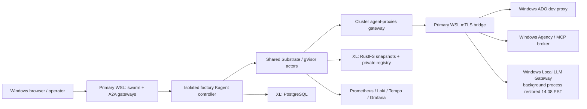

# Devbox agent environment

Consolidated current-state map of the three WSL devboxes, Azure WireGuard hub, Kubernetes, Kagent/Substrate, Windows
credential/proxy services, factory/swarm, and observability.

**Current implementation:** [Overnight handoff](IMPLEMENTATION-HANDOFF.md) records
the subsequently approved consolidation, live state, validation and rollback.
The inventory below is the historical discovery baseline, not the latest process list.

**Baseline observed:** 2026-11-03, approximately 13:50-14:00 PST / 21:50-22:00 UTC.
This is a point-in-time inventory, not desired state or a claim that every end-to-end operation works.
Discovery was read-only; no deployments, credentials, firewall rules, or disks were changed.
The missing Windows LLM process/listener and healthy cluster connectivity were rechecked at 14:05 PST / 22:05 UTC.
**Subsequent approved action:** the Windows LLM gateway was started in a detached background process and verified at
14:08 PST / 22:08 UTC. Host and authenticated WSL bridge health/model discovery now pass, with 30 models.

## Start here

| Document | What it answers |
|---|---|
| [AgencyCoder deployment and enrollment](AGENCY-CODER.md) | Current immutable harness image, fixture retirement, scoped actor-JWT enrollment, strict-TLS renewal and verified no-inference repository/plugin acceptance |
| [Cluster portal migration](CLUSTER-PORTAL.md) | Single-host paths, verified UI/API prefixes, compatibility aliases and the pending observability-data decision |
| [Read-only Headlamp](HEADLAMP.md) | Namespace/workload dashboard, local URL, expiring read-only login and verified denied actions |
| [Disposable A2A sanity check](A2A-SANITY.md) | One-command public coding/MCP/mixed-model acceptance, verified results, exact cleanup and retained state |
| [Test swarm preparation](swarms/test/PREPARATION.md) | Inactive twelve-role experiment, intent-only agent packet, empty ADO base, documentation/threat-model lifecycle, and activation gates |
| [Stable access and management](STABLE-ACCESS-AND-MANAGEMENT.md) | Stable default-port hostnames, the Windows administrator step, native read-only management agents, and the datastore warning |
| [Implementation handoff](IMPLEMENTATION-HANDOFF.md) | What has actually changed since the inventory, what runs now, and what remains gated? |
| [Consolidation plan](CONSOLIDATION-PLAN.md) | How should the host services, Kagent integration, telemetry, memory, session exports, and ADO credentials converge? |
| [Consolidation research](CONSOLIDATION-RESEARCH.md) | Which pinned source/API contracts support the plan, and where are the compatibility gaps? |
| [Topology](TOPOLOGY.md) | Which machines, networks, tunnels, addresses, and ports connect everything? |
| [Services and source catalog](SERVICES.md) | What runs where, who starts it, and where is its implementation/configuration? |
| [Request flows and trust](REQUEST-FLOWS.md) | How do A2A, inference, Git/packages, MCP, identity, and telemetry actually flow? |
| [State and recovery](STATE-AND-RECOVERY.md) | What persists, where are the disks/backups, and what fails together? |
| [Operations](OPERATIONS.md) | Where are the UIs, how can state be inspected safely, and what is the recovery order? |
| [Simplification candidates](SIMPLIFICATION.md) | What can likely be consolidated or retired, and what must be verified first? |
| [Evidence and uncertainty](EVIDENCE.md) | What was verified, which older notes are stale, and what was not tested? |

## The short version

There are **three different execution/management layers**, not one:

1. Three WSL Ubuntu hosts run an HA MicroK8s control plane over a hub-and-spoke Azure WireGuard network.
2. Kagent/Substrate runs sandboxed agents on that cluster. An original `kagent` pilot and an isolated
   `factory-executions` controller coexist, sharing Substrate and PostgreSQL infrastructure.
3. Primary WSL runs eight role-specific A2A gateway processes plus a Swarm Manager. Windows on primary hosts ADO
   authentication/proxying and the shared Agency/MCP broker. Inference is configured to depend on a separate Windows
   Local LLM Gateway.

The older Podman agent fabric, remote gateway transports, and WAM IMDS broker are still present as source/artifacts,
but were **not running** in the inspected primary-host runtime.

## Most important findings

| Finding | Meaning |
|---|---|
| All three nodes Ready; 45 Running pods ready; one completed initialization pod | Kubernetes health is good at this snapshot. It does not prove agent or inference health. |
| Windows LLM process was absent; subsequently started at the operator's request | Now listening on `172.24.160.1:4141`; host and mTLS bridge health/model discovery pass. Cause of its earlier absence is unknown; persistent startup is not configured by this action. |
| ADO control health and Windows Agency broker health returned 200 | The two running Windows capability services are alive; upstream token validity and writes were not exercised. |
| PostgreSQL, RustFS, and registry PVs are all XL-local | Three control-plane nodes do not make application state HA. |
| Two Kagent controllers and five worker pods coexist | Original model-free pilot: three workers. Factory: two workers, currently primary and XL. |
| Tempo direct readiness works; localhost `13200` fails | A stale access forward can look like a broken tracing backend. |
| `factory-api` RemoteMCPServer has `Accepted=False / DiscoveryFailed` | This registration is not healthy even though its controller pod is ready. |
| Original `engsys-agency-coder` actor is crashed on devbox-2 | Its actor failure is separate from the now-Ready node. No recovery was attempted. |
| Observability has no PVCs | Prometheus/Loki/Grafana/Alertmanager use ephemeral volumes; Tempo data is in its container filesystem. |
| devbox-2 has a logon recovery task whose last result was failure | Boot/recovery automation differs between hosts and is not proven reliable. |
| Argo controller remains, but there are no Workflows/Templates/CronWorkflows | The retired factory workflow path still has a running controller. Confirm other consumers before retiring it. |

## Scope and handling

This set records infrastructure and configuration **locations**, not secret values, prompts, source payloads,
task results, or personal Git identities. Do not copy protected state into this folder.

Existing component instructions remain the authority for changing those components. The inventory itself does not authorize
cleanup, further service changes, live inference, branch/PR writes, certificate rotation, or destructive recovery.

At discovery, `Q:\src` and this new folder were not Git repositories, and the active
`Q:\tools\kagent-lab` package and `Q:\src\tools\ado-dev-proxy` were unversioned.
The approved execution phase subsequently established local source-only rollback
checkpoints; see the handoff for exact repositories, branches and commits.
