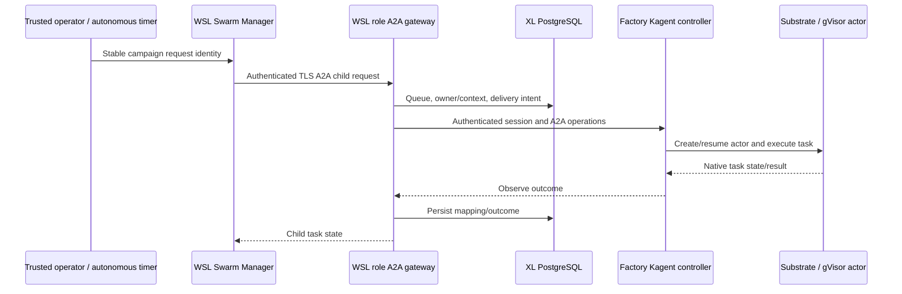
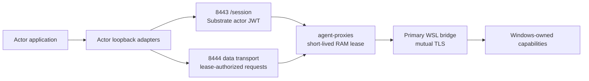

# Request flows and trust boundaries

[Index](README.md) | [Ports](TOPOLOGY.md) | [Component ownership](SERVICES.md).

## A2A and agent execution



The WSL gateways use `factory.gateway_tasks` in the shared XL PostgreSQL database.
Kagent/Substrate owns sessions, placement, snapshots, and native task outcomes. The Swarm Manager records parent/child
correlation; it is not the actor scheduler.

Identical requests with stable message identities deduplicate; changed input conflicts. Ambiguous delivery must be
observed rather than blindly replayed. This is best-effort durability, not exactly-once external writes.
Argo is **not** in the current request path.

The custom factory controller verifies a protected bearer token and scopes access to `factory-executions`.
The original Kagent controller remains a separate insecure pilot. Do not merge the two boundaries merely to reduce
deployment count.

## Common actor-to-host capability path



The cluster gateway is `agent-proxies.proxy-access.svc.cluster.local`.
Session admission uses inspected HTTPS port `8443` and a Substrate-injected actor JWT. Data transport uses
TLS passthrough on `8444`, preserving nested proxy traffic. The gateway checks issuer, audience, expiration, and actor
identity, then grants a RAM-only lease bounded to five minutes.

The audience is `https://agent-proxies.proxy-access.svc/session`.
Factory setup explicitly grants `factory-executions` in addition to the original `proxy-access` integration.
The unauthenticated original `kagent` controller must not become an alternative admission path to host authority.

The gateway connects to `10.82.0.2` with a dedicated client certificate. The primary WSL bridge requires mutual TLS.
Upstream GitHub and WAM credentials stay on Windows. The bridge does hold the separate LLM gateway key in RAM.
Actor leases, bridge mTLS credentials, the LLM gateway key, and host upstream credentials are different authorities.

## Inference

```text
Actor Copilot SDK / Responses client
  -> actor loopback http://127.0.0.1:14141/v1
  -> authenticated cluster gateway data port 8444
  -> primary WSL mTLS bridge 10.82.0.2:15441
  -> configured Windows http://172.24.160.1:4141
  -> LocalLlmGateway
  -> GitHub Copilot subscription inference
```

LocalLlmGateway supports `/v1/models` and native `/v1/responses`, including SSE. It uses a separate client gateway
key, performs upstream authorization on Windows, and does not replay inference.
Its documented default concurrency is four. The subsequent background launch overrides only host, port, and key-file
selection; other options retain the application's existing configuration/environment/default precedence.

**Initial gap, subsequently resolved:** the Windows process/listener was absent, and bridge health timed out.
At the operator's request the gateway was started in the background. At 14:08 PST, host health and authenticated
model discovery succeeded, and the existing mTLS WSL bridge returned health 200 and 30 models.
No inference or actor task was submitted. This verifies the host/bridge metadata path, not a fresh end-to-end actor
inference request.

The integration is an unofficial Copilot subscription adapter. Consolidation should preserve entitlement/automation
policy checks rather than assuming it is a supported general inference service or a monetary budget manager.

## Git, npm, and NuGet

```text
Actor Git / npm / dotnet
  -> actor loopback explicit proxy http://127.0.0.1:15480
  -> authenticated gateway transport 8444
  -> primary WSL mTLS bridge 10.82.0.2:15480
  -> credential-free Windows interop stdio relay
  -> Windows AdoDevProxy 127.0.0.1:5480
  -> approved canonical Azure DevOps / Azure Artifacts HTTPS origin
```

This is an explicit CONNECT proxy with HTTPS interception, **not an ADO REST reverse proxy**.
The Windows service obtains ADO delegated tokens directly through MSAL/WAM. No IMDS token vending is required.
Original Git URLs, `.npmrc`, lockfiles, and `NuGet.Config` are retained.

The current host configuration approves MSASG and the 1ES `EngSys_Consume` feeds. It allows Git smart HTTP, including
push, package consumption, and the supported npm audit operations. ADO REST administration, package publication,
public npm, SSH Git, Git LFS, arbitrary destinations, and generic tunneling are not supported routes.

Opted-in runtimes trust only the **public** ADO interception CA; Node/npm also uses `NODE_EXTRA_CA_CERTS`.
Never project the CA signing key, DPAPI state, Windows user profile, or token cache into actors.
Proxy variables are routing instructions, not by themselves an egress security boundary.

The separate older Docker path is:

```text
Docker container on internal ado-dev-proxy bridge
  -> 172.18.0.1:5480 socat relay
  -> Windows stdio transport
  -> same loopback Windows AdoDevProxy
```

That bridge listener still exists despite no running Docker workloads. It is not the three-host Substrate transport.

## Agency plugins and MCP tools

```text
Actor SDK HTTP MCP client / plugin-policy request
  -> actor loopback 127.0.0.1:15442 /agency/mcp, /agency/plugins, /agency/policy
  -> authenticated cluster capability gateway
  -> primary WSL mTLS Agency bridge 10.82.0.2:15442
  -> fixed Windows interop relay
  -> Windows Agency broker 127.0.0.1:15442
  -> one shared Agency stdio MCP gateway
  -> approved ADO / Bluebird / EngHub / WorkIQ / PR-watch tool instances
```

The host broker binds actor UID/subject pairs to profiles. Callers cannot choose a more privileged profile through a
header. New factory actors are bound using the host configuration helper; a public binding export contains UID/subject
mapping, while the protected broker state retains authority and approved Git identity.

| Profile | Intended authority |
|---|---|
| `engsys-reader` | Read-oriented ADO/code/docs/WorkIQ subset; no repository write or PR-watch tools |
| `engsys-contributor` | Engsys contribution and selected work-item/PR operations |
| `slopmop-contributor` | Writes scoped to owned SlopMop source branches and disposable integration target; selected PR-watch tools |
| `slopmop-triage` | Selected scoped work-item writes, not repository PR creation |

The SlopMop target is `users/nibeauli/slopmop-devel`; owned source branches begin
`users/nibeauli/slopmop-demo-`. These are policy details of the current deployment, not permission to change branches.

Plugin archives are host-fetched under marketplace/policy restrictions and content-hash checked. Guest-side plugin
availability is not permission to launch arbitrary host commands. ADO REST tool operations use this Agency path,
not the Git/package proxy.

## Telemetry

| Signal | Actual path | Important distinction |
|---|---|---|
| Kubernetes/node metrics | Prometheus Operator monitors -> Prometheus -> Grafana | Pull/scrape, not an OTLP metrics pipeline |
| Kagent/Substrate metrics | Authenticated/allowed controller and runtime targets -> Prometheus | Six pilot targets included among 34 healthy active targets |
| Pod stdout/stderr | Promtail on each node -> Loki -> Grafana | This does not automatically collect WSL systemd journals or Windows logs |
| Substrate traces | OTLP gRPC -> `tempo.observability.svc:4317` | Runtime env uses about 1% parent-based trace sampling; OTLP logs/metrics disabled |
| Swarm lifecycle spans | WSL manager -> `http://10.152.183.202:4318/v1/traces` | Direct OTLP HTTP using a configured ClusterIP; lifecycle metadata, not prompts/tool bodies |

No standalone OpenTelemetry Collector deployment was found. Tempo is the trace backend, not a substitute collector
for every signal. Grafana provisioned sources include Prometheus, Loki, and Tempo.
There is a direct dependency on the configured Tempo ClusterIP in protected WSL manager configuration.

The shared gateway, WSL bridges, role frontends, and Windows services have different liveness/authentication layers.
Healthy Prometheus targets do not currently prove these whole request chains work.
