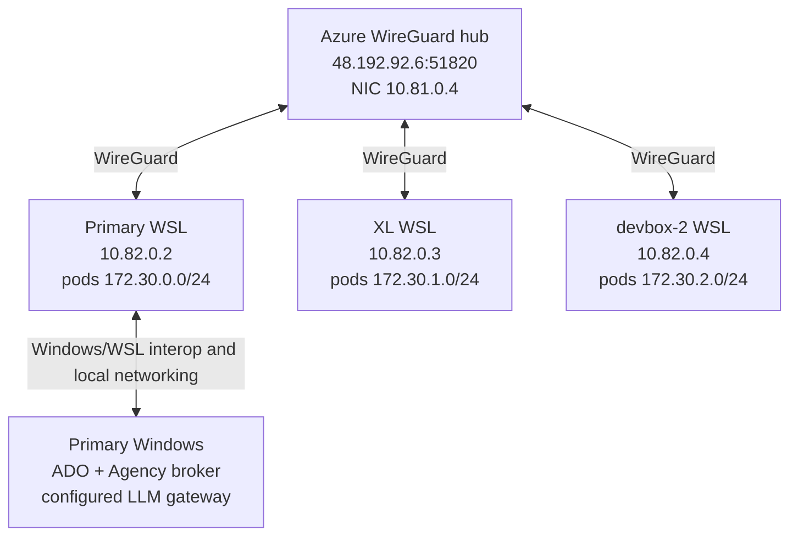

# Topology and addressing

[Index](README.md) | Snapshot and verification details: [Evidence](EVIDENCE.md).

## Physical/logical hosts

All three Kubernetes nodes run Ubuntu 26.04.1 LTS under WSL2, kernel `6.18.33.2-microsoft-standard-WSL2`,
MicroK8s `v1.36.2`, and containerd `2.2.3`.

| Site | Windows/WSL hostname | Kubernetes name | WireGuard IP | Routed pod site | Capacity reported to Kubernetes |
|---|---|---|---|---|---|
| primary-devbox, this box | `CPC-nibea-8T76E` | `cpc-nibea-8t76e` | `10.82.0.2/32` | `172.30.0.0/24` | 16 CPU, about 31 GiB RAM |
| xl-devbox | `CPC-nibea-2L35I` | `cpc-nibea-2l35i` | `10.82.0.3/32` | `172.30.1.0/24` | 32 CPU, about 63 GiB RAM |
| devbox-2 | `CPC-nibea-4MEMO` | `cpc-nibea-4memo` | `10.82.0.4/32` | `172.30.2.0/24` | 16 CPU, about 31 GiB RAM |

These are WSL/Kubernetes capacities, not a separately measured Windows physical hardware inventory.
All three are control-plane members and schedulable worker hosts.

| Dynamic local address | Observed value | Caution |
|---|---|---|
| Primary Windows WSL-facing adapter | `172.24.160.1` | Hardcoded in the model bridge and old gateway examples |
| Primary WSL eth0 | `172.24.161.36/20` | Also the source in the legacy Windows proxy firewall rule |
| XL WSL eth0 | `192.168.53.205/20` | Not the stable Kubernetes identity |
| devbox-2 WSL eth0 | `172.31.33.17/20` | Not the stable Kubernetes identity |

WSL NAT addresses may change. The stable inter-host addresses are the WireGuard addresses.

## Azure WireGuard hub

Verified through read-only Azure Resource Manager queries:

| Item | Value |
|---|---|
| Subscription | `CloudWorkStations + MSASGTools Email Bots` |
| Resource group / region | `nibeauli-hub` / `westus2` |
| VM | `nibeauli-hub-vm`, `Standard_B2pts_v2`, running |
| VM NIC private addresses | `10.81.0.4`, `fd81:0:0:1::4` |
| Static public IPv4 | `48.192.92.6` |
| Public DNS | `nibeaulihub-krn2gfikk2rlg-v4.westus2.cloudapp.azure.com` |
| WireGuard ingress | UDP `51820`, NSG source `CorpNetPublic` |
| Overlay route table | `nibeauli-hub-overlay-rt`: `10.82.0.0/24` via `10.81.0.4` |
| Infrastructure source | `Q:\src\tools\wireguard-hub` |
| Checked-in site inventory | `Q:\src\tools\wireguard-hub\main.bicepparam` |

All three live WSL peers report the same WireGuard endpoint, `48.192.92.6:51820`.
Primary's recent handshake and traffic counters confirmed an active tunnel.
This is **hub-and-spoke**, not direct peer-to-peer full mesh.

The source config describes a private routing hub with no peer Internet NAT. ARM shows a deny rule for forwarded
Internet egress and hub-originated HTTP/HTTPS allowances. The hub's running Linux nftables configuration was not inspected.
No Azure VM Run Command was invoked.

## Kubernetes networking

| Layer | Observed configuration |
|---|---|
| Node identity | WireGuard `10.82.0.2`, `.3`, `.4` |
| HA datastore | dqlite masters on each node at TCP `19001` |
| Calico | One `/24` pool per site; `/26` allocation blocks; VXLAN Always; IP-in-IP Never; NAT outgoing enabled |
| Primary MTUs | `wg0=1420`; `vxlan.calico=1370` |
| Service network | Service addresses in `10.152.183.0/24`; Kubernetes service `10.152.183.1` |
| Cluster DNS | `kube-dns=10.152.183.10`; `cluster.local`; other queries forwarded using CoreDNS `/etc/resolv.conf` |
| Public ingress | No Ingress resources; MicroK8s ingress and MetalLB add-ons disabled |
| External access | WSL loopback forwards for UIs; WireGuard TLS listeners for A2A and host bridges |

Primary routes the other two site `/24`s through `wg0`, with specific remote Calico `/26` routes via `vxlan.calico`.
The VXLAN-under-WireGuard path accounts for the lower pod MTU.

The old Podman examples also use `172.30.*` addresses. Those examples are not evidence of live Podman networking:
the Podman machine is stopped, and the live pools are now Calico-managed. Do not restart old stacks without checking
CIDR and routing conflicts.

## Operator-facing and host-bridge ports

| Bind location | Port | Purpose | Observed status |
|---|---:|---|---|
| Windows `127.0.0.1` | 5480 | ADO explicit CONNECT/interception proxy | Listening |
| Windows `127.0.0.1` | 5481 | ADO token-free `/health` | HTTP 200 |
| Windows `127.0.0.1` | 15442 | Agency broker | `/health` HTTP 200 |
| Windows `172.24.160.1` | 4141 | Local LLM Gateway | Started after inventory; health and authenticated model discovery pass |
| Windows, legacy default | 5443 | WAM IMDS token broker | No listener found |
| Windows, legacy example | 8090 | Aggregate MCP relay target | No listener found |
| Primary WSL `10.82.0.2` | 15441 | mTLS model host bridge | Health/model discovery pass after Windows gateway startup |
| Primary WSL `10.82.0.2` | 15480 | mTLS ADO transport bridge | Listening |
| Primary WSL `10.82.0.2` | 15442 | mTLS Agency transport bridge | Listening |
| Primary WSL `10.82.0.2` | 18443-18450 | Eight role-specific authenticated A2A gateways | All corresponding services running |
| Primary WSL `10.82.0.2` | 18451 | Swarm Manager TLS control/dashboard | Service running |
| Primary WSL `127.0.0.1` | 18452 | Read-only swarm dashboard/API/SSE | Windows HTTP 200 |
| Primary WSL `127.0.0.1` | 18080 | Factory Kagent UI forward | Windows HTTP 200 |
| Primary WSL `127.0.0.1` | 13000 | Grafana forward | `/api/health` HTTP 200 |
| Primary WSL `127.0.0.1` | 19090 | Prometheus forward | 34 active targets, all up |
| Primary WSL `127.0.0.1` | 13100 | Loki forward | `/ready` HTTP 200 |
| Primary WSL `127.0.0.1` | 13200 | Tempo query forward | Existing forward not responding |
| Primary WSL `127.0.0.1` | 18093 | Factory controller backend forward | Existing process; managed by factory backend helper |
| Primary WSL Docker bridge `172.18.0.1` | 5480 | Older credential-free ADO stdio relay | Listening; no Docker containers running |

Windows `wslrelay` listeners expose many WSL loopback services to Windows localhost. They are not separate copies
of those services. Windows had no `netsh interface portproxy` entries.
The same port `15442` exists in three namespaces: Windows broker, WSL TLS bridge, and actor loopback adapter.

## Infrastructure ports

| Port | Layer |
|---|---|
| UDP 51820 | Azure hub WireGuard ingress |
| UDP 44314 | Primary local WireGuard socket at inspection; not the hub's fixed port |
| TCP 22 | WSL SSH, primary bound to WireGuard address |
| TCP 16443 | MicroK8s Kubernetes API |
| TCP 19001 | dqlite, bound to node WireGuard address |
| TCP 25000 | MicroK8s cluster agent |
| UDP 4789 | Calico VXLAN |
| TCP 10250 | Kubelet |
| TCP 10257 / 10259 / 10249 | Controller-manager / scheduler / kube-proxy metrics |
| TCP 9100 | Node exporter |

Listener presence is not an Internet exposure assessment. WSL NAT, Windows firewall, Linux filtering, WireGuard,
and Kubernetes policy all affect reachability; a complete external reachability test was not performed.
